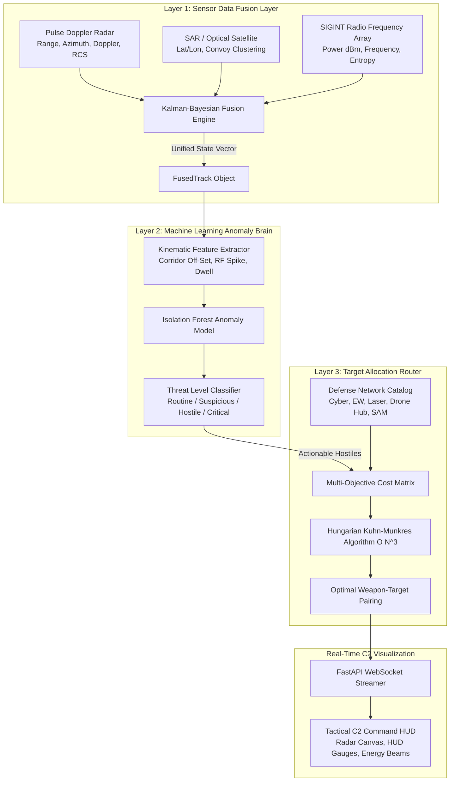

# autonomous_kill_web: AI-Driven Sensor-to-Shooter Simulation Architecture

[](https://github.com/Vivekkumar161122/automated_preemptive_suppression_architecture/actions)
[](https://opensource.org/licenses/MIT)
[](https://www.python.org/downloads/)
[](https://fastapi.tiangolo.com)
[](https://scikit-learn.org/)
[](https://scipy.org/)

---

## 📌 Executive Summary
The **Autonomous Kill-Web** is an AI-powered defense network prototype engineered for rapid threat identification and automated resource allocation. 

In contested multi-domain operational theaters, legacy centralized Command and Control (C2) suffers from high latency across the **OODA loop** (Observe, Orient, Decide, Act). This system establishes a decentralized **Sensor-to-Shooter Kill-Web** that automates the left-of-launch preemptive suppression of mobile Transporter Erector Launchers (TELs), autonomous drone swarms, and hypersonic threats.

---

## 🏗️ System Architecture



---

## ⚡ Key Modules & Technical Stack

| Layer | Technical Implementation | Purpose |
|---|---|---|
| **Layer 1: Sensor Fusion** | Python, NumPy, Pandas, Kalman Filter | Fuses noisy radar logs, space-based GPS telemetry, and RF chatter into a coherent Cartesian track with quantified Bayesian uncertainty. |
| **Layer 2: Anomaly Detection** | Scikit-Learn (Isolation Forest) | Unsupervised pattern recognition trained on peacetime civilian baselines to detect anomalous left-of-launch military staging. |
| **Layer 3: Target Allocation** | SciPy (`linear_sum_assignment`) | $O(N^3)$ Kuhn-Munkres Hungarian optimizer minimizing cost and collateral risk while maximizing kill probability ($P_k$). |
| **Backend Orchestrator** | FastAPI, Uvicorn, WebSockets | Asynchronous event loop streaming real-time simulation updates at 10 Hz to all connected clients. |
| **C2 Tactical HUD** | HTML5 Canvas, Vanilla CSS3, Web Audio API | Glassmorphic military dashboard rendering 60 FPS vector radar sweeps, range rings, and dynamic kill-web allocation beams. |

---

## 🚀 Quickstart Guide

### 1. Prerequisites
* Python 3.10+ (tested with Python 3.11, 3.12, 3.14)
* Git

### 2. Installation & Launch
```bash
# Clone the repository
git clone https://github.com/Vivekkumar161122/automated_preemptive_suppression_architecture.git
cd automated_preemptive_suppression_architecture

# Run the automated launch script
chmod +x run.sh
./run.sh
```

### 3. Accessing the Tactical Command Console
Navigate your browser to:
```
http://127.0.0.1:8000
```
* **Interactive API Documentation (Swagger)**: [http://127.0.0.1:8000/docs](http://127.0.0.1:8000/docs)

---

## 🧪 Running the Automated Test Suite

The project includes unit and integration tests covering the fusion filter, anomaly engine, Hungarian allocator, and REST endpoints:
```bash
PYTHONPATH=. .venv/bin/pytest tests/ -v
```

---

## 🎯 Pre-Loaded Tactical Scenarios
1. **Left-of-Launch Mobile TEL (`left_of_launch_tel`)**:
   A rogue mobile Transporter Erector Launcher deviates 15 km off designated highway corridors into concealment, initiates RF telemetry bursts, and prepares for ballistic launch. The AI assigns an instantaneous Cyber-Physical exploit and EW jamming to preempt launch.
2. **Multi-Axis Drone Swarm (`multi_axis_swarm`)**:
   A high-speed, evasive autonomous UAV swarm attacks across multiple compass bearings. The Hungarian router pairs tactical EW jammers and C-UAS interceptor drones simultaneously.
3. **Hypersonic Glide Vehicle (`hypersonic_vector`)**:
   Hypersonic vector at Mach 5+ detected. Defensive Directed Energy Weapon (High-Energy Laser) and kinetic SAM battery are paired in under 3 ms.
4. **Peacetime Baseline (`peacetime_patrol`)**:
   Normal commercial airliner and ground logistics traffic operating within corridor limits with zero false alarms.

---

## 📖 Academic Documentation & Viva Preparation
* Includes:
  * Formal Mathematical Problem Statements (Kalman Filter state equations, Isolation Forest average path length, Hungarian cost matrices)
  * Data Flow Diagrams (DFD Level 0, 1, and 2)
  * Top 10 Viva Voce Examination Questions with Model Answers

---

## 📄 License
This project is licensed under the MIT License - see the [LICENSE](LICENSE) file for details.
